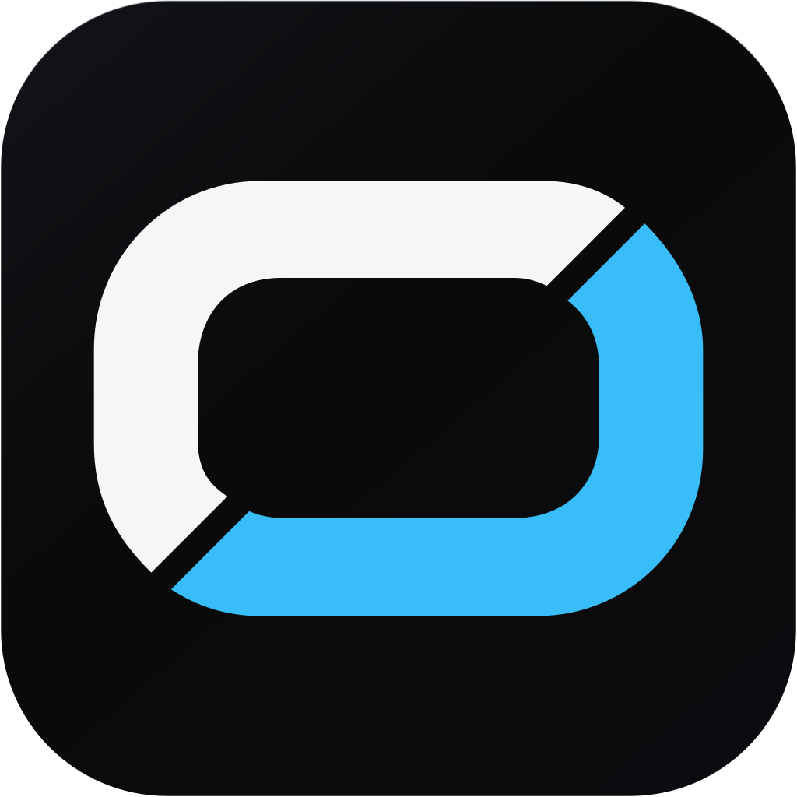

<p align="center">
  <a href="https://zerovdd.dev">
    
  </a>
</p>

<h1 align="center">ZeroVDD (<code>zerovdd</code>)</h1>

<p align="center">
  A production-grade Windows 11 UMDF 2 / IddCx 1.10 Virtual Display Driver, managed Session-0 service, CLI, and native Win32 system tray companion engineered in Rust for low-latency LizardByte Sunshine / Moonlight streaming and standalone virtual displays.
</p>

<p align="center">
  <a href="https://zerovdd.dev">Documentation</a> &middot;
  <a href="https://zerovdd.dev/getting-started/installation/">Install</a> &middot;
  <a href="https://zerovdd.dev/getting-started/sunshine/">Sunshine Setup</a> &middot;
  <a href="https://github.com/zerovdd/zerovdd/releases">Releases</a>
</p>

## Highlights

- **Dynamic per-client virtual displays:** Zero monitors at boot (with optional `headless_standby`), deterministic `MonitorContainerId`, synthesized EDID 1.4 + CTA-861-G (customizable `--ppi` physical sizing, `bt709` / `bt2020` / `dci-p3` gamuts, `8` / `10` / `12` bpc bit-depth caps, per-display HDR10 luminance overrides, or verbatim `--edid <path>` binaries), and 64-bit VESA CVT-RBv2 timings up to 8K@240Hz and fractional 59.94/119.88/239.76 Hz.
- **Layout & IPC ergonomics:** Full `--orientation` (`0`/`90`/`180`/`270` with portrait CCD dimensions), explicit `--position X,Y`, `--primary`, `zerovdd display restore`, and unprivileged Interactive User IPC parity (`display list`, `switch-gpu`, `restore`, and explicit `--guid`/`--gpu` over `\\.\pipe\zerovdd-svc`).
- **Native Win32 Tray (`zerovdd-tray.exe`):** Lightweight menu-on-click companion for quick display presets, in-place HDR and resolution switching, GPU switching, Sunshine control, physical display restore, config access, and doctor telemetry export.
- **Universal Driver compliance & security:** `DIRID 13` Driver Store isolation, `InfVerif /u /h /w`, `ApiValidator`, privileged IOCTLs isolated on `\ZeroVddControl` (`SYSTEM` + `Administrators`), per-handle `EvtFileCleanup`, and Session-0 `zerovdd-svc` crash/Lock-Screen/reboot recovery.
- **Zero-polling observability:** Event-driven swapchain processing and structured Windows ETW TraceLogging (`ZeroVdd.Driver`).

## Architecture

```text
zerovdd-cli (zerovdd.exe) / zerovdd-svc (zerovdd-svc.exe) / zerovdd-tray (zerovdd-tray.exe) [Layer 3]
  -> zerovdd-client (IOCTL + CCD + Win11 24H2 HDR/ACM) / zerovdd-installer [Layer 2]
  -> driver-wdk/zerovdd-driver + driver-wdk/zerovdd-iddcx-sys [Layer 2 WDK]
  -> zerovdd-engine [Layer 1, no_std]
  -> zerovdd-proto, zerovdd-edid, zerovdd-modes [Layer 0, no_std], zerovdd-config [Layer 0, std]
```

## Install

Install the signed Windows 11 MSI (x64 or ARM64) via WinGet or download it from [GitHub Releases](https://github.com/zerovdd/zerovdd/releases):

```powershell
winget install ZeroVDD.ZeroVDD
```

See the [Installation Guide](https://zerovdd.dev/getting-started/installation/) for MSI silent flags, Scoop, and manual driver installation, and the [Sunshine Setup Guide](https://zerovdd.dev/getting-started/sunshine/) for Moonlight/Sunshine streaming.

## Documentation

Full documentation lives at **[zerovdd.dev](https://zerovdd.dev)**:

- [Installation](https://zerovdd.dev/getting-started/installation/) and [Quickstart](https://zerovdd.dev/getting-started/quickstart/) -- MSI, WinGet, Scoop, CLI, and first virtual display
- [Sunshine Setup](https://zerovdd.dev/getting-started/sunshine/) -- LizardByte Sunshine hooks, HDR/24H2 ACM behavior, and crash recovery
- [Guides](https://zerovdd.dev/guides/displays-and-layouts/) -- Display layouts, custom EDIDs, HDR10 luminance, GPU selection, headless hosts, and system tray
- [CLI & Configuration Reference](https://zerovdd.dev/reference/cli/) -- Full `zerovdd` command syntax, `config.toml`, ETW tracing, and IPC security
- [Architecture](https://zerovdd.dev/architecture/overview/) -- Workspace DAG, Driver/UMDF internals, Session-0 console CCD trampoline, and [Testing Policy](TESTING.md)
- [Troubleshooting](https://zerovdd.dev/guides/troubleshooting/) -- `zerovdd doctor`, ETW tracing, and common fixes
- [Release & Code Signing](https://zerovdd.dev/release/signing-and-release/) -- Stage A/B/C signing, [SignPath Onboarding](https://zerovdd.dev/release/signpath-onboarding/), and [Code Signing Policy](https://zerovdd.dev/release/code-signing-policy/)

## Quickstart (Development)

Prerequisites: Rust (`rustup`, channel pinned in `rust-toolchain.toml`), `mise`, Git Bash (on Windows), and Visual Studio Build Tools + Windows 11 SDK/WDK (for driver builds).

```bash
# Configure git hooks and verify local tooling
mise run setup

# Run the full local verification gate
mise run verify:agent

# Build or preview the documentation site locally
mise run docs:build
mise run docs:dev

# Run individual checks
mise run fmt:check
mise run lint
mise run lints:static
mise run test:scripts
mise run test
```

See [CLAUDE.md](CLAUDE.md) for engineering conventions, [crates/AGENTS.md](crates/AGENTS.md) for the crate DAG and Rust rules, and [TESTING.md](TESTING.md) for the three-tier verification policy.

## Code Signing Policy

Free code signing provided by [SignPath.io](https://signpath.io), certificate by [SignPath Foundation](https://signpath.org).

See [docs/src/content/docs/release/code-signing-policy.md](docs/src/content/docs/release/code-signing-policy.md) ([zerovdd.dev/release/code-signing-policy/](https://zerovdd.dev/release/code-signing-policy/)) for signing governance, team roles, build provenance, and privacy guarantees, [docs/src/content/docs/release/signpath-onboarding.mdx](docs/src/content/docs/release/signpath-onboarding.mdx) for the SignPath Foundation onboarding checklist, and [docs/src/content/docs/release/signing-and-release.md](docs/src/content/docs/release/signing-and-release.md) for the technical three-stage Windows signing pipeline.

## License

Dual-licensed under MIT or Apache-2.0. See [LICENSE](LICENSE).
