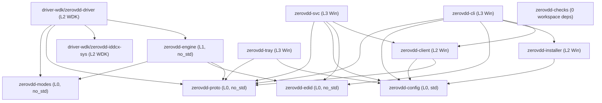

ZeroVDD separates pure domain math, driver state management, Windows display/CCD topology control, and privileged WDF/IddCx callbacks into strict acyclic layers. Dependencies flow strictly downward from Layer 3 to Layer 0, enforced automatically by `crate_dag_lint` inside `crates/zerovdd-checks`.

## Crate Dependency Graph

## Layer Responsibilities

- **Layer 0 (Pure domain & config, zero `windows` / `wdk` dependencies):**
  - `zerovdd-proto` (`#![no_std]` + `alloc`; `std` feature for IPC): Versioned binary IOCTL ABI (`v1.1.0`) with exact byte-length validation and length-prefixed JSON service IPC framing.
  - `zerovdd-edid` (`#![no_std]` + `alloc`): EDID 1.4 + CTA-861-G synthesizer (CIE chromaticity, configurable PPI physical sizing, bpc bits, HDR10 static metadata, deterministic per-monitor serial/name) and strict custom-EDID validator.
  - `zerovdd-modes` (`#![no_std]` + `alloc`): 64-bit overflow-proof VESA CVT-RBv2 timing math, GCD-reduced `RationalHz`, and a unified `VideoSignalInfo` mode planner shared across `ParseMonitorDescription2` and `MonitorQueryTargetModes2`.
  - `zerovdd-config` (`std`): Typed `ConfigV1` (`schema_version = 1`, `#[serde(deny_unknown_fields)]`) and atomic temp-file + rename persistence.
- **Layer 1 (Driver state engine, `#![no_std]` + `alloc`):**
  - `zerovdd-engine`: Re-entrancy-safe `Pending -> Active` monitor registry, D0/D3 adapter lifecycle state machine, handle/lease ownership, GPU-switch circuit breaker, and deterministic `FakeIddPlatform` simulator.
- **Layer 2 (Platform adapters):**
  - `driver-wdk/zerovdd-iddcx-sys`: UMDF 2.33 / IddCx 1.10 bindings and thin C-ABI inline-table trampoline (`c/iddcx_trampoline.c`).
  - `driver-wdk/zerovdd-driver`: UMDF 2 DLL (`zerovdd.dll`), Control Device gate, device-scoped D3D11 manager, zero-polling swapchain workers, unnamed hardware cursor handler, and ETW TraceLogging.
  - `zerovdd-client` (`cfg(windows)`): Control Device IOCTL client, CCD `QueryDisplayConfig`/`SetDisplayConfig` topology engine, Windows 11 24H2 split HDR/ACM manager, and DXGI GPU selector.
  - `zerovdd-installer` (`cfg(windows)`): SetupAPI/`newdev` Driver Store staging, `Root\ZeroVdd` device-node management, and pinned dev-cert helper.
- **Layer 3 (Binaries):**
  - `zerovdd-cli` (`zerovdd.exe`): `setup`, `display`, `edid`, `doctor`, `sunshine`, and hidden `internal-ccd`.
  - `zerovdd-svc` (`zerovdd-svc.exe`): Session-0 Windows service, ACL-protected named pipe, active console-session CCD trampoline, and `sunshine.exe` crash guardian.
  - `zerovdd-tray` (`zerovdd-tray.exe`): Native Win32 system tray companion communicating over `\\.\pipe\zerovdd-svc`.
- **Verification Crate (`zerovdd-checks`, zero workspace dependencies):**
  - Compiled AST/lexer static lints and isolated temp-repo hook/script integration tests.

## Why `driver-wdk/` Is an Isolated Sub-Workspace

`driver-wdk/` is excluded from the root `Cargo.toml` for three concrete reasons:

1. `zerovdd-driver` compiles as `#![no_std]` + `alloc` with `panic = "abort"` (`NoPanic` policy enforced statically by `driver_panic_policy_lint`) so `zerovdd.dll` passes `ApiValidator` with zero non-OneCore `std` imports. Setting `panic = "abort"` in the root workspace would break `#[should_panic]` host tests.
2. Root workspace tests, Clippy, and Linux `x86_64-pc-windows-msvc` typechecks run in seconds without requiring a Windows WDK installation.
3. Layer 0/1 crates (`proto`, `edid`, `modes`, `engine`) compile cleanly with `--no-default-features` in both workspaces.

## What to Read Next

- [Driver Internals](/architecture/driver-internals/) for UMDF 2 / IddCx 1.10 mechanics, locking, and swapchain processing.
- [Session-0 Trampoline](/architecture/session-zero-trampoline/) for console-session CCD orchestration and crash recovery.
- [Testing Policy](/architecture/testing-policy/) for the three-tier verification model.
