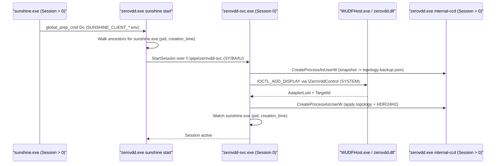

Windows Session 0 Isolation causes `QueryDisplayConfig`, `SetDisplayConfig`, and Advanced Color / HDR CCD APIs to fail with `ERROR_ACCESS_DENIED` when invoked directly from a `LocalSystem` Session 0 service. ZeroVDD splits driver ownership from interactive desktop CCD calls across a controlled session boundary.

## Streaming Session Sequence

## Component Responsibilities

### Privileged Service (`zerovdd-svc.exe`, Session 0)

- Runs as `LocalSystem` in Session 0.
- Listens on `\\.\pipe\zerovdd-svc` with strict DACL `D:P(A;;GA;;;SY)(A;;GA;;;BA)(A;;GRGW;;;IU)`.
- Owns persistent, headless-standby, and session Control Device handles on `\ZeroVddControl`.
- Atomically persists physical display layout snapshots to `%ProgramData%\zerovdd\topology-backup.json`.

### Console CCD Trampoline (`console_launcher.rs` -> `internal-ccd`)

When a topology snapshot, layout apply, or restore is needed:

1. Queries the active interactive console session via `WTSGetActiveConsoleSessionId()`.
2. Duplicates the service's own `LocalSystem` primary token via `OpenProcessToken` + `DuplicateTokenEx`.
3. Retargets `TokenSessionId` via `SetTokenInformation` to the active console session (`Session > 0`).
4. Spawns `zerovdd.exe internal-ccd <snapshot|apply|restore>` via `CreateProcessAsUserW` targeting `winsta0\default` (or `winsta0\winlogon` when at the Lock Screen / UAC secure desktop).

Because the helper executes inside the active console session with `LocalSystem` rights, `QueryDisplayConfig`, `SetDisplayConfig`, and Windows 11 24H2 `SET_HDR_STATE` / `SET_WCG_STATE` calls succeed on logged-in desktops, UAC prompts, and the Lock Screen (`Win+L`).

### Crash & Reboot Recovery (`session.rs`)

- **Process supervision:** `zerovdd-svc` opens the recorded `sunshine.exe` PID with `SYNCHRONIZE | PROCESS_QUERY_LIMITED_INFORMATION` and verifies `GetProcessTimes` matches `owner_creation_time` to prevent PID-reuse races. If `sunshine.exe` exits unexpectedly (crash or `taskkill /F`), the watcher immediately departs the virtual display and runs `internal-ccd restore`.
- **Reboot / BSOD recovery:** On service startup, if `%ProgramData%\zerovdd\topology-backup.json` exists on disk, `zerovdd-svc` restores physical monitors immediately when a console session is active, or defers restoration until `SERVICE_CONTROL_SESSIONCHANGE` delivers `ConsoleConnect`, `SessionLogon`, or `SessionUnlock`.
- **Fallback restore:** If no backup snapshot is present during `zerovdd display restore`, `restore_streaming_session_with_fallback` enables all attached physical display paths so users are never stranded on a blank monitor.
